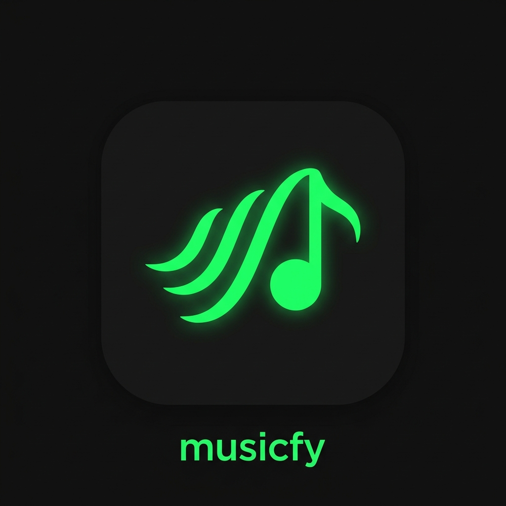

# 🎵 Musicify



**Musicify** is a sleek, feature-rich Flutter music player application designed to provide an immersive audio experience. Built with a beautiful dark-themed UI, it offers seamless playback, custom playlists, and advanced library search capabilities.

## ✨ Features

- **🎧 Seamless Audio Playback**: Powered by `just_audio` and `audio_service`, ensuring high-quality playback with background support.
- **📱 Background Controls**: Full integration with OS-level notifications (Play, Pause, Next, Previous) using a custom `AudioHandler`.
- **🗂️ Custom User Playlists**: Create, rename, delete, and reorder your own playlists. Easily add songs from your search or library.
- **🔍 Smart Library Search**: Search for genres or languages (e.g., "Malayalam songs", "Tamil rap songs") to instantly browse curated libraries.
- **🎨 Premium UI/UX**: A stunning dark mode interface with glassmorphism elements, fluid animations, and beautiful album art integrations.
- **💾 Offline Support**: Browse and play downloaded/local music directly from your device.

## 🚀 Getting Started

### Prerequisites
- Flutter SDK (^3.12.2)
- Android Studio / VS Code
- An Android/iOS device or emulator

### Installation

1. **Clone the repository**
   ```bash
   git clone https://github.com/arjuntopscore/muicfy.git
   cd muicfy
   ```

2. **Install dependencies**
   ```bash
   flutter pub get
   ```

3. **Run the app**
   ```bash
   flutter run
   ```

## 🏗️ Architecture

- **State Management**: `provider` for robust and scalable state handling.
- **Audio Engine**: `just_audio` combined with `audio_service` for reliable background and lock-screen playback.
- **Storage**: `shared_preferences` for persisting user playlists, favorites, and app settings.

## 🤝 Contributing

Contributions, issues, and feature requests are welcome! Feel free to check the [issues page](https://github.com/arjuntopscore/muicfy/issues).

## 📄 License

This project is licensed under the MIT License - see the LICENSE file for details.
